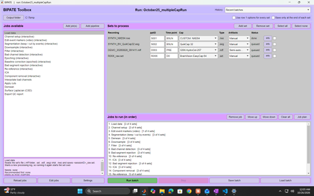

# BIPATE 1.0.0 (Bespoke Integrative Preprocessing and Analysis Toolbox for EEG) 
  
BIPATE is a MATLAB and EEGLAB add-on created as a versatile toolbox for electrophysiology researchers.

## Purpose and Function
This is to be a running project, adding additional features and functionality as time goes on. The ultimate goal of this package is to curate both easier collaboration and possible standardization across projects and research labs. The secondary goal is to be visually appealing. In its current form, the app supports a multitude of semi-standard functions most often used in EEG preprocessing (no analysis quite yet), as well as support for files from BrainVision, EEGLAB, EGI, EDF/EDF+, and Nexstim. Features in BIPATE include: filtering, segmentation, epoching, semi-automated bad channel detection, multiple kinds of ICA, and event editing compatible with video. A few things are worth noting about this package...

- Steps like bad segment rejection or bad channel rejection do not directly affect the data initially. Instead they form a "mask" that it hands to the 'Apply Cuts' function which then removes these marked artifacts from the data. Regardless of how 'Apply cuts' is used (whether after the entirety of a pipeline or after each removal step), the app was built to preserve event markers and datetime data (the overnight technicians, fret not over a missed marker!).
- BIPATE is batch-based, meaning that you can run, save, and edit batches of EEG files all at once. Creating batches automatically puts files through the same pipeline (unless instructed not to) one at a time (only one file is loaded in at a time to prevent 'Out of Memory' crashes)
- The 'Edit event markers (video)' function allows you to change, delete, and add events in the EEG recording. This can also be paired with video to assist in event correction.
- There are manual and semi-automated artifact rejection modes (with a planned automated version). The manual version just uses eeglab's built-in segment rejection and a simple list-based channel rejection. By activating semi-automatic rejection, you can auto-mark ICA components and run a variety of bad channel detection methods to give you candidate artifacts.
- QC (Quality Control) figures are generated at multiple different steps and can also generate a summary of preprocessing by using the 'Export QC report' function

Please feel free to reach out directly to bipatecoding@gmail.com to report bugs or raise suggestions.

## Requirements
- MATLAB: 2023b (tested)
- Toolboxes: Signal Processing Toolbox, and Statistics and Machine Learning Toolbox
- EEGLAB: 2023.1 (tested)
- Required Plugins: Biosig, Fileio, ICLabel, clean_rawdata, firfilt, MFFMatlabIO
- Optional Plugins: PICARD, AMICA, FastICA, viewprops (The component viewer can still work on the Lite version without viewprops)

## Installation
1. Download or clone BIPATE
2. Add **only** the top folder (labeled BIPATE) to your path
3. Run `bipate` in the command window
4. On the first launch, the welcome window asks for name, credentials, institution, and an optional form
5. The program will ask you to give it the path to the EEGLAB folder (whatever folder contains eeglab.m)

## Get acquainted with a Demo
A synthetic demo file comes included with the package for you to play with
1. Launch BIPATE and click **Add Set** --> **.mff folder**
2. Navigate to **~\BIPATE\testData** and select the **DEMO_20260828_091411.mff** folder
3. Enter a Participant ID and a Time point (i.e. what visit/experiment protocol). Make sure the cap is *GSN HydroCel-257*
4. Select a folder in the top left **Output folder** to output cleaned files into
5. Add whatever jobs you'd like by selecting them (hold CTRL to select multiple) and pressing **Add job(s)**,  or press **Add pipeline** for a generic pipeline to be added
6. Interact with the pop-ups and enjoy!

## Supported file types
- EGI: .mff *folders* that have their own file picker. DO NOT remove .mff extensions from these folders or the finder will not recognize them. If you have multiple .mff files, select the folder *containing* all of the recording files; select all the ones you'd like to use and they’re joined into one set in recording order.
- EEGLAB: .set files. since this application is backboned by eeglab, all files are converted to .set
- EDF/EDF+: .edf files. (EDF+ annotations become events)
- BrainVision: .vhdr/.vmrk/.eeg files. Picking a .eeg file also picks up the two sidecars
- Nexstim: .nxe files.

## Jobs List
Use the automated detection methods at your own risk, they have not been validated (with the exception of clean_rawdata in the bad channel detectors)

| Job | Function | User Input | Extension |
|-----|----------|------------|-----------|
| Load Data | loads data into the BIPATE-friendly .set files | none | _raw |
| Channel setup | cross-checks channel location and metadata against saved channel locations, also gives options to split peripheral channels off or tuck them away into EEG.etc | peripheral channel selection, peripheral labeling, split files | _chanSetup, _splitChannels (holds split channels) |
| Edit event markers (video) | allows addition, removal, or editing of events. is able to view video alongside if an mp4 is available | Video Editor GUI | _videoEdited |
| Segmentation | use span, global, or periodic rules to cut segments out of the data, or to split a recording | segmentation GUI | _segmented (or _segment001, _segment002 if split into multiple files) | 
| Downsampling | downsamples data to target frequency | target frequency (if not set in settings) | _resampled |
| Filter | low-pass, high-pass, and notch filtering. can add more than one notch filters (comma separated) | filter frequencies (if not set in settings) | _filtered |
| Bad channel detection | remove artifact-heavy channels (semi-automated gives options for detectors) | detector selection, channel removal, other data to help you out in decisions | _badChanFlag |
| Epoching | epoch data around a type of event marker | event marker selection, window | _epoched |
| Baseline correction | corrects baseline of epoched data | baseline window | _baselined |
| Bad segment rejection | EEGLAB's segment rejection window (detectors coming soon) | click and drag over bad stretches of data, REJECT to mark sections as bad | _segmentRejection_raw or _segmentRejection_component |
| Re-reference | rereference data according to selected method | re-reference method (if not set in settings) | _preICAreref, _preICA2reref, _finalReRef (depending upon where you re-reference) |
| ICA | run one of four types of ICA | none (preview window only) | _ICA1, _ICA2, ... |
| Component removal | remove ICA classified components (semi-automated autoticks components above threshold for removal) | component selections for removal | _componentRemoval1, ... |
| Interpolate bad channels | interpolates channels using nearby channel info | none | _interp |
| Apply cuts | applies channel and segment masks from steps above and removes them from the EEG.data field | none | _maskCut |
| Demean | subtracts channel mean from all samples (or baseline's mean if epoched) | none | _demeaned |
| Surface Laplacian | estimates the scalp current density (the spatial second derivative), which sharpens topographies and reduces volume conduction | none | _laplacian |
| Export QC report | creates summary figures and logs from previously ran steps | none | no .set writes |

Generally, running a step again in the same batch will append the next round number to the suffix

You can also add in your own jobs or edit the jobs.json file with the two buttons in the lower left corner. Do this at your own risk, I cannot guarantee your additions or changes will be compatible with the GUI runner.

## Segmentation
Segmentation can be incredibly powerful and versatile. As a result, it can be a bit unintuitive at first.
- There is a slider button on the bottom "Keep or Cut", whichever it is set to is the rule for the whole step (you can run segmentation more than once). **Cut** will use your removals to add to the removal mask, **Keep** does the opposite
- You build one or more rules from recording times or events. There are 3 kinds of rules: span, global, and periodic
    - Span - Mark from one event to another (plus or minus an offset on either). Example: **keep** from *eyeo* -5 seconds to *eyec* +5 seconds.
    - Global - Takes a "start-type" event and "end-type" event and applies the rule to every instance (also plus or minus an offset). Example: cut from every *move* marker until the following *move* marker
    - Periodic - Fixed length windows repeated from an anchor event, set by a period, phase, and duration. Example: keep 30s every 5 min after *dose*
- Nothing is deleted, only added to the removal mask which can only be applied by 'Apply cuts'
- At the end, it will ask if you would like to split the recording into one file per kept segment (this **will** lose your 'cut' data)
- It only works on continuous data, so run before epoching if running both for some reason

## Running batches
Whenever running a file or multiple, BIPATE will ask you to name the batch. This batch name is saved in the **History** dropdown in the top left. So, if you decide to close everything down and want to pick it up later, all you have to do is open up the run from the dropdown! This feature allows for project specific sets and progress all kept neatly in simple metadata

*I realized I made a mistake after I pressed Run!* There is a big red **Stop** button in the bottom row. Clicking this puts a stopping command in the queue and kills the run after the current job finishes (the pop up box also has this button). If you stop in the middle of a run, only finished steps are saved to the disk and all you need to do to continue is press **Run Batch** again. A quick warning box will pop up giving you the option of making this a new batch or continuing under the current name.

*I finished all my jobs but I need to add another one!* You can add jobs *and* still keep working in your batch. A warning message will pop up, as in continuing a stopped set. That warning box can allow potentially for multiple routes when testing different analyses and processing steps.

*I ran a step with the wrong settings!* The **Job plan** menu has a great amount of flexibility here, including rerunning steps (*note: all steps in the job plan after this job will also be rerun*). Simply, click on the step you wish to rerun (not on the checkbox) and press **Rerun highlighted**.

*I want to run a bunch of sets but not all with the same jobs!* The **Job plan** again comes in handy here. Those checkboxes can be turned off for each specific file you are processing. You can also SHIFT click multiple of the jobs (again not on the checkboxes) and use the **Highlighted on** and **Highlighted off** buttons. And if you want to do the opposite, the header checkboxes allow you to run the same settings from the first set on all the rest of the files; this is incredibly useful on quick steps like 'Channel setup'. If you're running a batch of all identically recorded sets, you could also press the **Use row 1 options for every set** which has the same functionality but also locks in things like cap type and artifact mode.

*I forget to pay for another 500GB of storage, and I can't fit copies from each step!* Ticking **Save only at the end of each set** only saves a file at its last ran step. Typically this should be after the final step in the Job plan, but if a job fails, the save will occur on the last successful job.

## Settings
- General: The default settings for new files you add in (cap type, ICA method, artifact mode), saving options (folder and when-to-save), and your EEGLAB folder path

- My Pipeline: You can customize and create different pipelines here.

- Misc: Chime after finishing, "Done" popups, QC figure opening behavior

- Channel setup: shows your custom caps here and allows you to edit them

- Edit event markers (video): allows you to create easy to insert event markers and color them

- Downsample: change default target frequency and change asking behavior

- Filter: change default filters and asking behavior

- Bad channel detection: CTRL click or SHIFT click to change your default (highlighted) detection methods

- Baseline correction (epoched): change default baseline window

- Re-reference: change default re-referencing settings and asking behavior

- ICA: edit high pass and AMICA threads

- Component removal: set confidence threshold for automated bad component rejection

- Apply cuts: edit how short segments are dealt with

- Demean: change baseline window for demeaning epoched data

- Surface Laplacian: change spline order, smoothing lambda, Legendre terms, and head radius

Other settings tabs may be empty at this time.

## Updating
Updating BIPATE should be fairly simple. Cloning from the repository is the recommended method, as that should directly make the changes; just clone and then `git pull` to update. With that being said, using the .zip file replacing the current BIPATE folder should also be safe, as all of your personal preferences are saved in a sidecar folder in your personal MATLAB folder, typically at \Documents\MATLAB\BIPATE_user.

## Known Limitations and Roadmap
The young age of this package is its weakest point. If you are ever bored, *please* try to cause crashes and send them to me at bipatecoding@gmail.com--you'd make my day. This application will be continuously updated and more features and versatility will be added over time.

### Current Limitations
1. Currently runs on Windows 11 but untested on macOS or Linux, or older versions of Windows
2. Nexstim files have not been directly tested, only synthetic copies. Additionally, only a few cap types (GSN HydroCel 257 and BrainVision EasyCap 64) have been tested, the other channel location files listed are pulled from EEGLAB.
3. Synced video only works on .mff files using the movieSyncs file. Video can still be used otherwise, but syncing must be done outside of BIPATE. Video is also not a requirement for the event editor
4. Artifact handling in semi-automatic is not fully automatic, it still requires A. validation and B. user review. A fully automated mode is planned.
5. Bad-channel detector methods are tuned on 256 channels--caps with less channels may see a reduced performance.
6. Channels with no location in a specific file are dropped in channel setup. To avoid this, use your own channel location file or use the 'Other' option with no chanloc file selected. Caps without locations are unable to use topoplots, interpolation, or the surface Laplacian.
7. Segmentation only currently works on continuous data (so must be used before epoching)
8. No parallel processing. Files are loaded in and processed one at a time since very long or large sets have a high demand for RAM
9. Interactive steps need someone at the computer. You can reduce the amount of keystrokes with using the same settings for all files, but the first file will always have a lot of interaction.
10. No analysis or statistics yet (I know, the name is misleading), and no BIDS export
11. Appending recording files (Works only for .mff files)
12. Personal settings are stored locally (though transfering the folder to another computer and overwriting the existing files can add your preferences)

### Planned additions
- New sounds to play when finished (I know not everyone wants to hear a C diminished chord, but at least you can turn it off)
- An artifact 'dictionary' and more/better synthetic files for training and educational purposes
- ASR
- Better line-noise removal
- More event editing tools
- Channel selection and renaming as a separate job
- Detrending
- EOG regression
- Auto-written methods section for papers
- Scripted batch runs without window / parallel processing
- Exporting batch settings as a shareable file
- HTML QC report
- Bad segment detection methods
- Automated bad channel detection and bad segment detection validation, and thus confidence to add in the 'Automated' artifact detection method.
- BIDS export
- More customization in the settings
- REST re-referencing
- Source localization
- Improved progress pop-up
- 3D channel mapping display
- FNIRS compatibility
- Adding in more caps to the package
- New plotting GUI for EEG traces
- Analyses
- Sleep scoring window (and automated sleep scoring)

## Changes to EEG struct
Nothing is fundamentally changed about the struct variable made by EEGLAB, but there are significant additions you should be aware of if you take one of these files into code outside of BIPATE
| new field | contents |
|-----------|----------|
| EEG.masks.chan.keepMask | channels to keep |
| EEG.masks.seg.keepMask | segments to keep |
| EEG.masks.epoch.keepMask | epochs to keep |
| EEG.etc.processing_done | tag of every step applied to the data, in order. DO NOT edit, BIPATE uses these to know what's been done |
| EEG.etc.processing_log | time-stamped line from every step |
| EEG.etc.processed_by | name, credentials, institution |
| EEG.etc.mffFolder | source mff folder(s) |
| EEG.etc.videoFolder | where the video is held |
| EEG.etc.metaTime | recording start time |
| EEG.etc.metaTimeSource | whether start time came from the recording or a fallback |
| EEG.etc.chanSetupDropped | channels the cap had no location for |
| EEG.etc.peripheral | ExG channels split off in channel setup |
| EEG.etc.sample_map_original | original sample numbers |
| EEG.etc.sample_map_editable | after resampling/cuts |
| EEG.etc.eventBackup | event latency backup made when the first event edit is made |
| EEG.etc.lineNoise | .freq, .labels, .ratio, .measured (from Filter) |
| EEG.etc.reref | reference used at each re-reference |
| EEG.etc.ica_rank/ica_algo | ICA information from each round of ICA |
| EEG.etc.removed_components | components removed per ICA round |
| EEG.etc.EpochInfo, baselineWin, demean, laplacian | parameters for respective functions |
| EEG.etc.cutMasks | mask applied in 'Apply cuts' |
| EEG.etc.removal_log | what was removed in 'Apply cuts' |
| EEG.etc.originalEvent | events before cutting in 'Apply cuts' |
| EEG.etc.bad_channels | automatic and manual flags, reasons, thresholds, final list |
| EEG.etc.bipate_version | version number that the file was processed on |
| EEG.etc.mffFolders, mffPartStartSec, mffPartRecordTime | joined recording information |   

## Licensing
BIPATE is released under the MIT license -- see `LICENSE`

## How to cite

Barlow, J. (2026). BIPATE: Bespoke Integrative Preprocessing and Analysis Toolbox for EEG (Version 1.0.0) [Computer software]. Zenodo. https://doi.org/10.5281/zenodo.23656717

Use the **Cite this repository** button on the GitHub page.

## Contact
bipatecoding@gmail.com

## Acknowledgements
Collaborators on this project
- Matthew Banks for mentorship and guidance through many frustrating nights
- Charles Raison for keeping me employed and fed enough to make this project cohesive
- Richard Smith for the initial pipeline and continued support
- Mika Hess for the help on the video editor

BIPATE is built on EEGLAB and the following plug-ins--please cite them too!

-EEGLAB: Delorme, A., & Makeig, S. (2004). J Neurosci Methods, 134(1), 9–21. doi:10.1016/j.jneumeth.2003.10.009
-ICLabel: Pion-Tonachini, L., Kreutz-Delgado, K., & Makeig, S. (2019). NeuroImage, 198, 181–197. doi:10.1016/j.neuroimage.2019.05.026
-PICARD: Ablin, P., Cardoso, J.-F., & Gramfort, A. (2018). IEEE Trans Signal Process, 66(15), 4040–4049. doi:10.1109/TSP.2018.2844203
-AMICA: Palmer, J. A., Kreutz-Delgado, K., & Makeig, S. (2011). AMICA: An adaptive mixture of independent component analyzers with shared components. Technical report, -Swartz Center for Computational Neuroscience, UC San Diego.
-FastICA: Hyvärinen, A. (1999). IEEE Trans Neural Netw, 10(3), 626–634. doi:10.1109/72.761722
-FieldTrip: Oostenveld, R., Fries, P., Maris, E., & Schoffelen, J.-M. (2011). Comput Intell Neurosci, 2011, 156869. doi:10.1155/2011/156869
-BioSig: Vidaurre, C., Sander, T. H., & Schlögl, A. (2011). Comput Intell Neurosci, 2011, 935364. doi:10.1155/2011/935364.
-firfilt: Widmann, A., Schröger, E., & Maess, B. (2015). J Neurosci Methods, 250, 34–46.
-Surface Laplacian: Perrin, F., Pernier, J., Bertrand, O., & Echallier, J. F. (1989). Electroencephalogr Clin Neurophysiol, 72(2), 184–187. 
-Corrigendum: Electroencephalogr Clin Neurophysiol, 76, 565